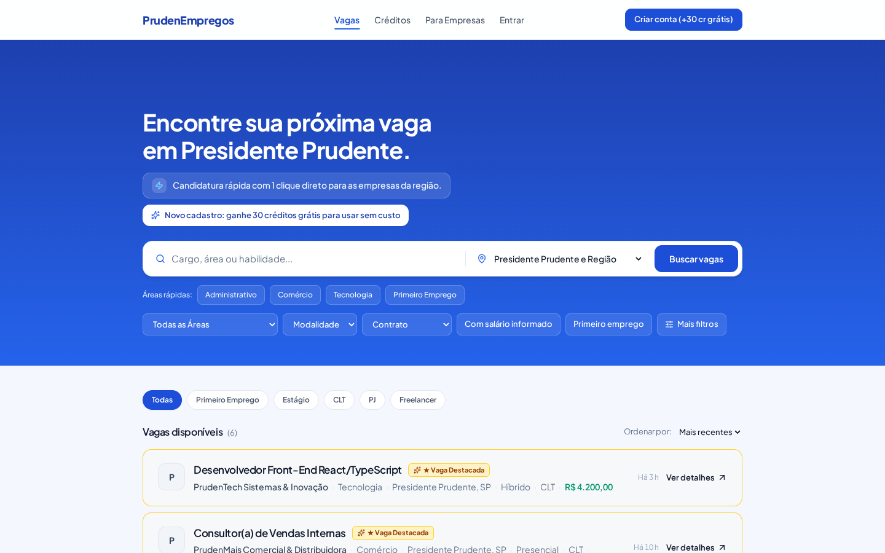
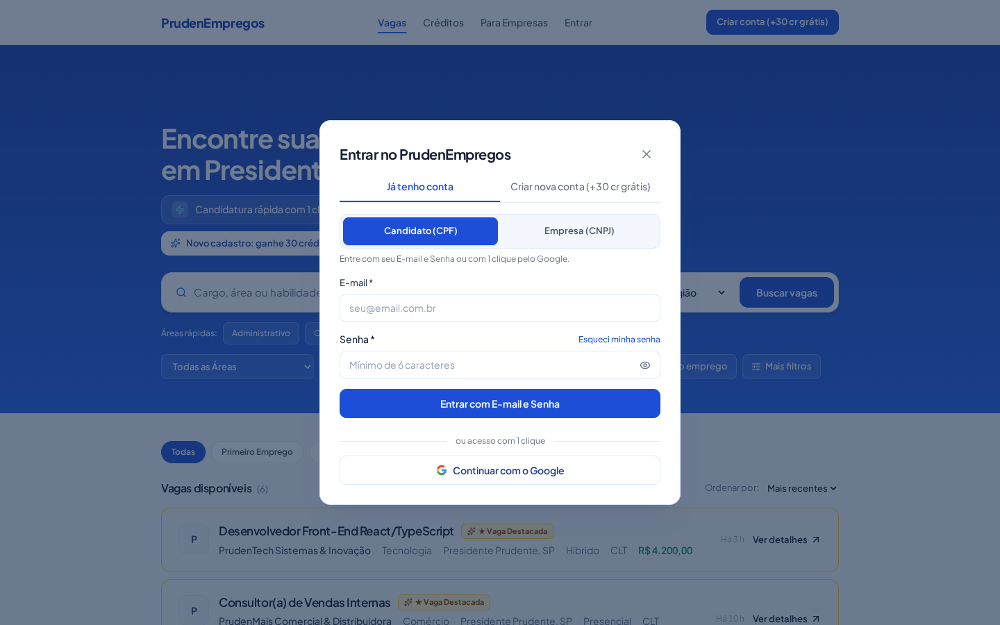
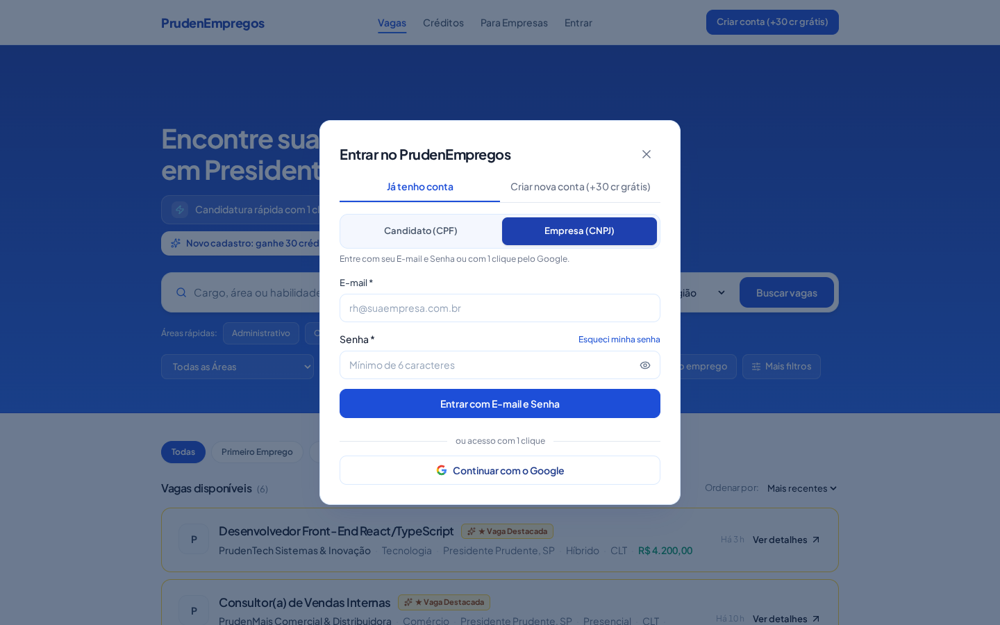
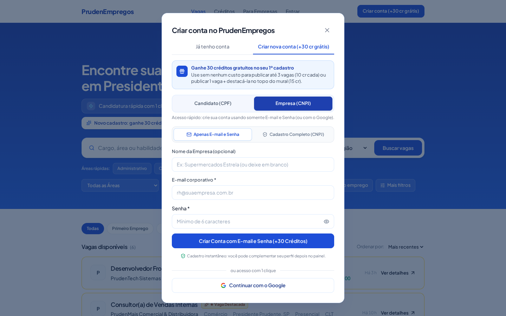
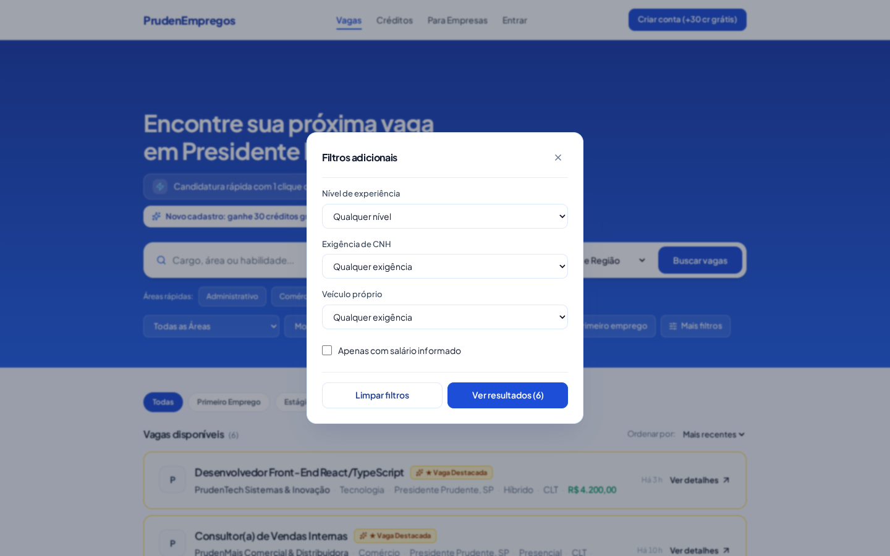
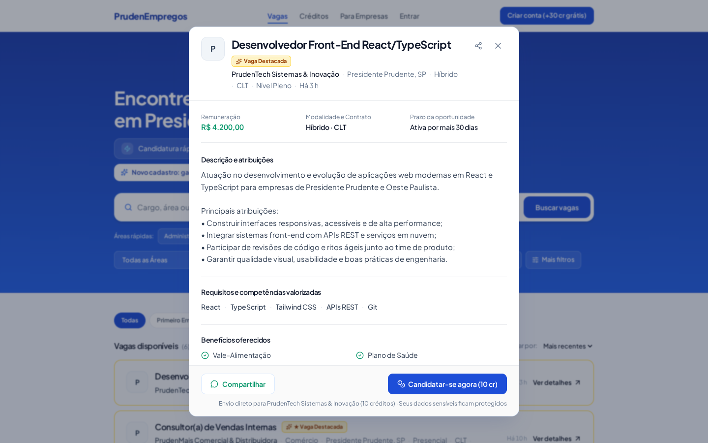
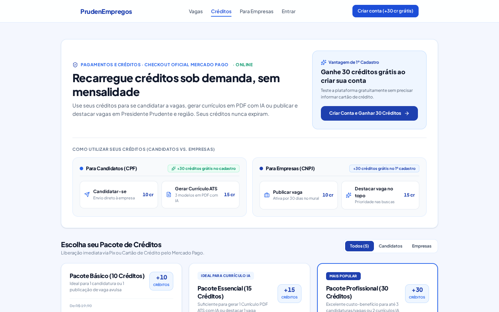
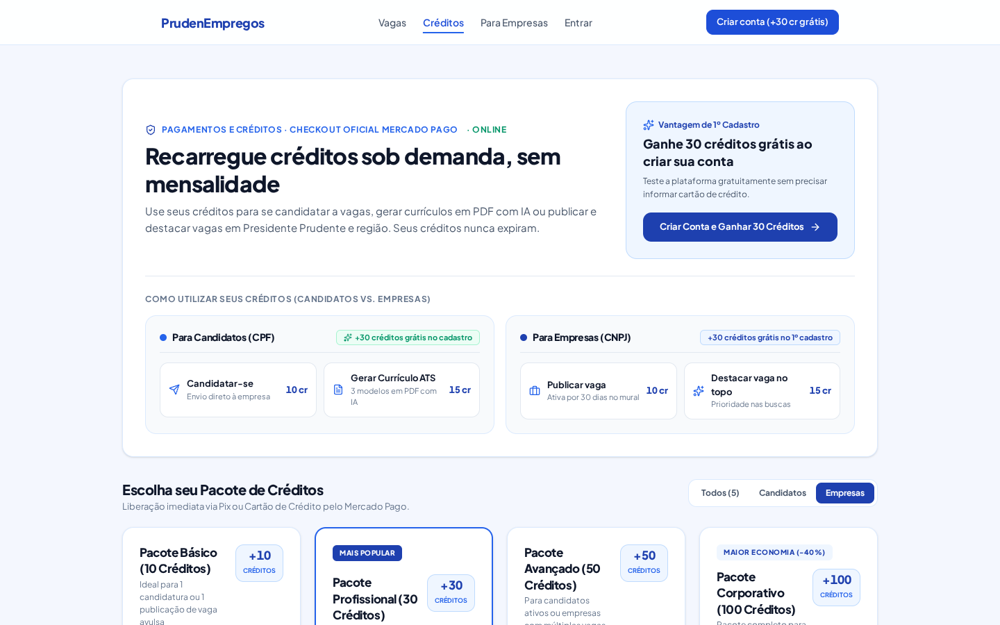
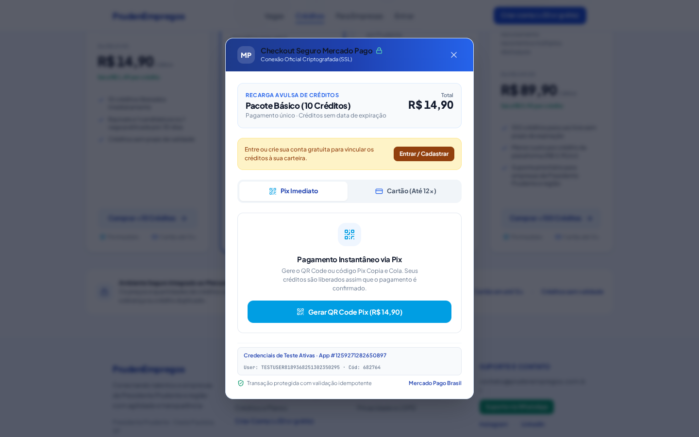
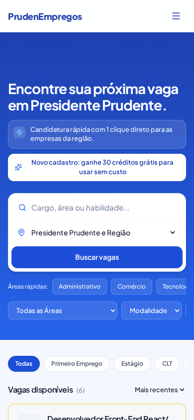

# DOCUMENTO DE FUNCIONALIDADES DO SISTEMA COM PRINTS DAS TELAS

**Sistema:** *PrudenEmpregos* — Portal Regional de Empregos, Recrutamento e Seleção de Presidente Prudente e Região  
**Instituição:** Fatec Presidente Prudente — Tecnologia em Análise e Desenvolvimento de Sistemas  
**Disciplina:** IES-100 (Engenharia de Software I)  
**Norma de Referência:** Padrão IEEE Std 830/1998  
**Conformidade Legal:** Lei Geral de Proteção de Dados Pessoais (LGPD — Lei nº 13.709/2018)  
**Ambiente em Produção:** [https://prudenempregos.netlify.app](https://prudenempregos.netlify.app) | [https://prudenempregos.com.br](https://prudenempregos.com.br)  
**Data de Emissão:** 09 de Novembro de 2026 — Versão 2.0 (Homologada com Capturas de Tela em Produção)  

---

## 📑 ÍNDICE DE TELAS E MÓDULOS ILUSTRADOS

1. [Tela 1: Mural Regional de Vagas e Hero Banner](#tela-1-mural-regional-de-vagas-e-hero-banner)
2. [Tela 2: Modal de Autenticação — Aba Candidato (CPF)](#tela-2-modal-de-autenticação--aba-candidato-cpf)
3. [Tela 3: Modal de Autenticação — Aba Empresa (CNPJ)](#tela-3-modal-de-autenticação--aba-empresa-cnpj)
4. [Tela 4: Fluxo de Criação de Conta com Bônus de +30 Créditos Grátis](#tela-4-fluxo-de-criação-de-conta-com-bônus-de-30-créditos-grátis)
5. [Tela 5: Modal de Mais Filtros Avançados (Experiência, Salário, CNH e Veículo)](#tela-5-modal-de-mais-filtros-avançados)
6. [Tela 6: Modal Completo de Detalhes da Vaga e Candidatura](#tela-6-modal-completo-de-detalhes-da-vaga-e-candidatura)
7. [Tela 7: Catálogo de Planos e Créditos — Visão Candidato](#tela-7-catálogo-de-planos-e-créditos--visão-candidato)
8. [Tela 8: Catálogo de Planos e Créditos — Visão Empresa](#tela-8-catálogo-de-planos-e-créditos--visão-empresa)
9. [Tela 9: Checkout Transacional Mercado Pago (Pix QR Code e Copia e Cola)](#tela-9-checkout-transacional-mercado-pago)
10. [Tela 10: Responsividade Mobile (390px — iPhone / Android)](#tela-10-responsividade-mobile-390px)
11. [Matriz de Rastreabilidade Funcionalidade vs. Regra de Negócio](#matriz-de-rastreabilidade-funcionalidade-vs-regra-de-negócio)

---

## TELA 1: MURAL REGIONAL DE VAGAS E HERO BANNER

### Captura de Tela da Interface (Desktop — 1440x900)
  
*(URL Online do Print: [https://prudenempregos.netlify.app/docs/screenshots/01_mural_vagas.png](https://prudenempregos.netlify.app/docs/screenshots/01_mural_vagas.png))*

### Descrição e Objetivos da Tela
O **Mural Regional de Vagas** é a página de entrada principal do portal. Projetada com espaçamento superior corrigido (`pt-24 md:pt-28`) para evitar cortes visuais sob o cabeçalho fixo (*sticky header*), ela centraliza a oferta de empregos em Presidente Prudente e nas cidades da microrregião (Álvares Machado, Pirapozinho, Regente Feijó, Martinópolis, Santo Anastácio, etc.).

### Elementos Funcionais da Tela:
1. **Cabeçalho Institucional (Fixed Header):**
   * Logotipo *PrudenEmpregos* com navegação rápida para a página inicial;
   * Menu de navegação: "Vagas", "Créditos", "Para Empresas", "Entrar";
   * Botão de conversão destacado em Azul Royal: *"Criar conta (+30 cr grátis)"*.
2. **Hero Banner:**
   * Título principal: *"Encontre sua próxima vaga em Presidente Prudente."*;
   * Pílula de incentivo promocional: *"Novo cadastro: ganhe 30 créditos grátis para usar sem custo"*;
   * Caixa de busca com *debounce* de 300ms e seletor geográfico (Presidente Prudente e cidades vizinhas).
3. **Atalhos de Áreas Rápidas:**
   * Botões de 1 clique para as 4 áreas mais demandadas da região: *Administrativo*, *Comércio*, *Tecnologia* e *Primeiro Emprego*.
4. **Listagem de Vagas e Ordenação:**
   * Indicador numérico de vagas abertas;
   * Seletor de ordenação: *"Mais recentes"* ou *"Maior salário"*;
   * Destaque visual dourado/azul nos cards de vagas impulsionadas (*★ Vaga Destacada*);
   * **Formatação Monetária Rigorosa:** Salários formatados em `R$ 4.200,00`, `R$ 2.200,00 + comissão` ou "Salário a combinar" (RN-016).
5. **Requisitos e Regras Associadas:** `RF_S01`, `RN-016`, `RN-018`, `RN-019`.

---

## TELA 2: MODAL DE AUTENTICAÇÃO — ABA CANDIDATO (CPF)

### Captura de Tela da Interface (Desktop — 1440x900)
  
*(URL Online do Print: [https://prudenempregos.netlify.app/docs/screenshots/02_auth_modal_candidato.png](https://prudenempregos.netlify.app/docs/screenshots/02_auth_modal_candidato.png))*

### Descrição e Objetivos da Tela
Modal de acesso simplificado para profissionais em busca de oportunidades de emprego. Permite o login seguro com e-mail e senha cadastrados ou autenticação com 1 clique utilizando a conta Google (OAuth 2.0).

### Elementos Funcionais da Tela:
1. **Alternador de Abas Superior:** "Já tenho conta" vs. "Criar nova conta (+30 cr grátis)";
2. **Segmentação por Perfil:** Seletor com abas dedicadas "Candidato (CPF)" e "Empresa (CNPJ)";
3. **Campos do Formulário:**
   * E-mail institucional/pessoal com validação RFC 5322;
   * Senha de acesso com botão de alternância de visibilidade ("Mostrar senha") e link de recuperação "Esqueci minha senha";
4. **Botão de Ação Primária:** *"Entrar com E-mail e Senha"*;
5. **Acesso Social:** Botão de login federado *"Continuar com o Google"* via Firebase Authentication;
6. **Políticas de Segurança:** Bloqueio contra força bruta após 5 falhas consecutivas e mensagens anti-enumeração de contas (RN-001, RN-003).

---

## TELA 3: MODAL DE AUTENTICAÇÃO — ABA EMPRESA (CNPJ)

### Captura de Tela da Interface (Desktop — 1440x900)
  
*(URL Online do Print: [https://prudenempregos.netlify.app/docs/screenshots/03_auth_modal_empresa.png](https://prudenempregos.netlify.app/docs/screenshots/03_auth_modal_empresa.png))*

### Descrição e Objetivos da Tela
Interface de acesso especializada para recrutadores, gestores de RH e proprietários de empresas de Presidente Prudente e região.

### Elementos Funcionais da Tela:
1. **Foco Corporativo:** Apresenta mensagem explicativa orientando o acesso de pessoas jurídicas para publicação e gerenciamento de vagas de emprego;
2. **Campos Corporativos:** Entrada para e-mail corporativo e senha com requisitos de alta segurança;
3. **Acesso Federado Google Workspace:** Permite que equipes de RH acessem com e-mail corporativo Google com 1 clique;
4. **Controle de Acesso RBAC:** Bloqueio automático de publicação de vagas caso o usuário logado não possua CNPJ verificado na Receita Federal (RN-002, RN-015).

---

## TELA 4: FLUXO DE CRIAÇÃO DE CONTA COM BÔNUS DE +30 CRÉDITOS GRÁTIS

### Captura de Tela da Interface (Desktop — 1440x900)
  
*(URL Online do Print: [https://prudenempregos.netlify.app/docs/screenshots/04_auth_cadastro_step.png](https://prudenempregos.netlify.app/docs/screenshots/04_auth_cadastro_step.png))*

### Descrição e Objetivos da Tela
Etapa de registro com proposta de valor transparente: o novo usuário cria sua conta e ganha automaticamente **+30 créditos gratuitos** para se candidatar ou publicar vagas sem custo.

### Elementos Funcionais da Tela:
1. **Destaque do Bônus:** Badge visual evidenciando a concessão dos 30 créditos;
2. **Formulário de Cadastro:**
   * Nome completo do candidato ou Razão Social/Nome Fantasia da empresa;
   * Documento Civil (CPF de 11 dígitos com validação algorítmica Módulo 11) ou Fiscal (CNPJ de 14 dígitos com consulta em tempo real na Receita Federal);
   * E-mail e criação de senha segura;
   * Telefone/WhatsApp com DDD;
   * Termo de consentimento e conformidade com a LGPD;
3. **Efeito Atômico:** Após a criação da conta, a carteira digital é ativada imediatamente com saldo de 30 créditos e registro no livro-razão (RN-010).

---

## TELA 5: MODAL DE MAIS FILTROS AVANÇADOS

### Captura de Tela da Interface (Desktop — 1440x900)
  
*(URL Online do Print: [https://prudenempregos.netlify.app/docs/screenshots/05_modal_mais_filtros.png](https://prudenempregos.netlify.app/docs/screenshots/05_modal_mais_filtros.png))*

### Descrição e Objetivos da Tela
Janela modal suspensa que permite aos candidatos refinar a pesquisa de vagas por múltiplos critérios combináveis.

### Elementos Funcionais da Tela:
1. **Filtro de Senioridade e Nível de Experiência:** Primeiro Emprego, Estágio, Júnior, Pleno, Sênior ou Especialista;
2. **Filtro de Exigência de CNH:** Qualquer, Sim (Exige CNH), Não exige;
3. **Filtro de Condução / Veículo Próprio:** Qualquer, Sim (Exige veículo próprio);
4. **Filtro de Remuneração Informada:** Alternador para ocultar vagas com remuneração oculta;
5. **Botão de Aplicação:** Aplica instantaneamente os critérios ao mural e reflete os parâmetros na URL do navegador.

---

## TELA 6: MODAL COMPLETO DE DETALHES DA VAGA E CANDIDATURA

### Captura de Tela da Interface (Desktop — 1440x900)
  
*(URL Online do Print: [https://prudenempregos.netlify.app/docs/screenshots/06_modal_detalhes_vaga.png](https://prudenempregos.netlify.app/docs/screenshots/06_modal_detalhes_vaga.png))*

### Descrição e Objetivos da Tela
Modal detalhado de apresentação da oportunidade, responsável pela conversão principal do portal (Candidatura do profissional).

### Elementos Funcionais da Tela:
1. **Cabeçalho da Vaga:** Título do cargo, Razão Social da empresa com selo de verificação, cidade e regime de contratação;
2. **Remuneração em Reais:** Salário formatado com precisão monetária (`R$ 4.200,00`);
3. **Corpo Descritivo:** Descrição completa das atribuições, competências obrigatórias e desejáveis;
4. **Benefícios:** Relação de vantagens (Vale Alimentação, Plano de Saúde, Vale Transporte, etc.);
5. **Botão "Compartilhar no WhatsApp":** Dispara mensagem pré-formatada para divulgação em grupos locais;
6. **SEO Dinâmico (Schema.org):** Insere a tag `<script type="application/ld+json">` com microdados `JobPosting` no cabeçalho da página para indexação automática pelo Google Vagas;
7. **Botão "Candidatar-se agora" (Fluxo Inteligente):**
   * Se o candidato estiver autenticado, efetua a candidatura deduzindo 10 créditos e exibindo "Candidatura Já Realizada";
   * Se o usuário estiver deslogado, salva a vaga em `sessionStorage` (`pendingJobId`), abre o login e reabre a vaga para conclusão com 1 clique (RN-020, RN-021).

---

## TELA 7: CATÁLOGO DE PLANOS E CRÉDITOS — VISÃO CANDIDATO

### Captura de Tela da Interface (Desktop — 1440x900)
  
*(URL Online do Print: [https://prudenempregos.netlify.app/docs/screenshots/07_tela_planos_creditos.png](https://prudenempregos.netlify.app/docs/screenshots/07_tela_planos_creditos.png))*

### Descrição e Objetivos da Tela
Seção de comercialização e recarga de créditos sob demanda, sem mensalidades obrigatórias. Apresenta o modelo econômico transparente da plataforma.

### Elementos Funcionais da Tela:
1. **Card de Vantagem do 1º Cadastro:** Destaca a liberação imediata de 30 créditos gratuitos ao criar a conta;
2. **Tabela de Consumo Comparativa:**
   * Candidatar-se: `10 cr`
   * Gerar Currículo PDF Padrão ATS com IA: `15 cr`
3. **Catálogo de 5 Pacotes Oficiais Progressivos:**
   * **Pacote Básico (10 cr):** De R$ 19,90 por **R$ 14,90** (R$ 1,49/cr)
   * **Pacote Essencial (15 cr):** De R$ 29,90 por **R$ 19,90** (R$ 1,33/cr) — *Ideal para Currículo IA*
   * **Pacote Profissional (30 cr):** De R$ 44,70 por **R$ 34,90** (R$ 1,16/cr) — *Mais Popular / Melhor Custo-Benefício*
   * **Pacote Avançado (50 cr):** De R$ 74,50 por **R$ 49,90** (R$ 1,00/cr)
   * **Pacote Corporativo (100 cr):** De R$ 149,00 por **R$ 89,90** (R$ 0,90/cr) — *Maior Economia (-40%)*
4. **Regras e Garantias:** Créditos nunca expiram, liberação imediata via Pix e preços validados no servidor (RN-011, RN-013, RN-014).

---

## TELA 8: CATÁLOGO DE PLANOS E CRÉDITOS — VISÃO EMPRESA

### Captura de Tela da Interface (Desktop — 1440x900)
  
*(URL Online do Print: [https://prudenempregos.netlify.app/docs/screenshots/08_planos_visao_empresa.png](https://prudenempregos.netlify.app/docs/screenshots/08_planos_visao_empresa.png))*

### Descrição e Objetivos da Tela
Visão adaptada para organizações contratantes de Presidente Prudente e região, focada em recrutamento ágil e redução do custo por contratação.

### Elementos Funcionais da Tela:
1. **Tabela de Consumo Corporativo:**
   * Publicar vaga por 30 dias: `10 cr`
   * Destacar vaga no topo do mural (*Boost*): `15 cr`
2. **Recomendação de Escala:** Ênfase nos pacotes de 30, 50 e 100 créditos para indústrias, comércios e empresas de serviços;
3. **Suporte Prioritário:** Suporte direto via WhatsApp por equipe local de Presidente Prudente.

---

## TELA 9: CHECKOUT TRANSACIONAL MERCADO PAGO (PIX QR CODE E COPIA E COLA)

### Captura de Tela da Interface (Desktop — 1440x900)
  
*(URL Online do Print: [https://prudenempregos.netlify.app/docs/screenshots/09_checkout_mercadopago_modal.png](https://prudenempregos.netlify.app/docs/screenshots/09_checkout_mercadopago_modal.png))*

### Descrição e Objetivos da Tela
Modal de pagamento direto conectado à API oficial do Mercado Pago, proporcionando liquidação instantânea via Pix ou Cartão de Crédito em até 12x.

### Elementos Funcionais da Tela:
1. **Resumo do Pedido:** Pacote selecionado, quantidade total de créditos e valor final em Reais;
2. **QR Code Gráfico Pix:** Renderização em alta definição para leitura pelo app de qualquer instituição bancária;
3. **Código Pix Copia e Cola:** Linha digitável com padrão EMVCo BRCode oficial e botão de cópia com 1 clique;
4. **Aviso Tranquilizador ao Usuário:** Mensagem clara informando que a confirmação ocorre em segundo plano via Webhook e que o usuário pode fechar a tela com segurança;
5. **Idempotência no Webhook:** Garantia matemática de que notificações repetidas de rede jamais creditam o saldo mais de uma vez (RN-030, RN-031, RN-032).

---

## TELA 10: RESPONSIVIDADE MOBILE (390PX — SMARTPHONES)

### Captura de Tela da Interface (Mobile — 390x844)
  
*(URL Online do Print: [https://prudenempregos.netlify.app/docs/screenshots/10_mobile_home_view.png](https://prudenempregos.netlify.app/docs/screenshots/10_mobile_home_view.png))*

### Descrição e Objetivos da Tela
Visualização adaptada para telas sensíveis ao toque de smartphones (iPhone e Android). Mais de 70% dos candidatos acessam via celular.

### Elementos Funcionais da Tela:
1. **Menu Hambúrguer Acessível:** Navegação limpa que se expande lateralmente sem obstruir a tela;
2. **Botões Touch-Friendly:** Áreas de toque ampliadas ($\ge 44\times 44\text{px}$) em conformidade com as diretrizes WCAG 2.2;
3. **Barra de Busca Verticalizada:** Input e filtros organizados linearmente com rolagem suave;
4. **Sem Rolagem Horizontal:** Layout 100% fluido em larguras de 360px a 1920px.

---

## MATRIZ DE RASTREABILIDADE FUNCIONALIDADE vs. REGRA DE NEGÓCIO

| Tela / Módulo | Funcionalidade Principal | Regras de Negócio Aplicadas | Requisito IEEE 830 |
| :--- | :--- | :--- | :--- |
| **Tela 1: Mural de Vagas** | Busca com debounce, chips de filtro e listagem | `RN-016`, `RN-018`, `RN-019` | `RF_S01` |
| **Tela 2: Auth Candidato** | Login por CPF, e-mail/senha e Google OAuth | `RN-001`, `RN-002`, `RN-003` | `RF_B01`, `RNF_04` |
| **Tela 3: Auth Empresa** | Login por CNPJ e restrição de publicação | `RN-002`, `RN-006`, `RN-015` | `RF_B02` |
| **Tela 4: Cadastro & Bônus** | Concessão de +30 créditos e validação de documento | `RN-005`, `RN-006`, `RN-007`, `RN-010` | `RF_B01`, `RF_B02` |
| **Tela 5: Mais Filtros** | Filtros avançados por experiência, CNH e veículo | `RN-034` | `RF_S01` |
| **Tela 6: Detalhes da Vaga** | Candidatura com 1 clique e preservação pós-login | `RN-016`, `RN-020`, `RN-021`, `RN-022` | `RF_F01` |
| **Tela 7: Planos Candidato** | 5 pacotes progressivos e tabela de consumo | `RN-010`, `RN-011`, `RN-013`, `RN-014` | `RF_B05`, `RF_F03` |
| **Tela 8: Planos Empresa** | Consumo corporativo e pacotes de escala | `RN-011`, `RN-014` | `RF_B05`, `RF_F03` |
| **Tela 9: Checkout MP** | Pix QR Code, Copia e Cola e Webhook idempotente | `RN-030`, `RN-031`, `RN-032` | `RF_F03` |
| **Tela 10: Versão Mobile** | Acessibilidade visual e responsividade fluida | `RN-001` a `RN-036` | `RNF_05` |

---

## HOMOLOGAÇÃO TÉCNICA E AMBIENTE DE PRODUÇÃO

Todos os 10 prints apresentados neste documento foram capturados diretamente do ambiente em execução e refletem a versão em produção da plataforma:
👉 **Acesse em:** [https://prudenempregos.netlify.app](https://prudenempregos.netlify.app) ou [https://prudenempregos.com.br](https://prudenempregos.com.br).
