# DOCUMENTO DE FUNCIONALIDADES DO SISTEMA COM PRINTS DAS TELAS

**Sistema:** *PrudenEmpregos* — Portal Regional de Empregos, Recrutamento e Seleção de Presidente Prudente e Região  
**Instituição:** Fatec Presidente Prudente — Tecnologia em Análise e Desenvolvimento de Sistemas  
**Disciplina:** IES-100 (Engenharia de Software I)  
**Norma de Referência:** Padrão IEEE Std 830/1998  
**Conformidade Legal:** Lei Geral de Proteção de Dados Pessoais (LGPD — Lei nº 13.709/2018)  
**Ambiente em Produção:** [https://prudenempregos.netlify.app](https://prudenempregos.netlify.app) | [https://prudenempregos.com.br](https://prudenempregos.com.br)  
**Data de Emissão:** 09 de Novembro de 2026 — Versão 3.0 (Manual Exaustivo de Telas e Funcionalidades Homologadas)  

---

## 📑 ÍNDICE GERAL DE TELAS E MÓDULOS DO SISTEMA

1. [Tela 1: Mural Regional de Vagas e Hero Banner](#tela-1-mural-regional-de-vagas-e-hero-banner)
2. [Tela 2: Modal de Autenticação — Aba Candidato (CPF)](#tela-2-modal-de-autenticação--aba-candidato-cpf)
3. [Tela 3: Modal de Autenticação — Aba Empresa (CNPJ)](#tela-3-modal-de-autenticação--aba-empresa-cnpj)
4. [Tela 4: Fluxo de Criação de Conta Unificada (+30 Créditos Grátis)](#tela-4-fluxo-de-criação-de-conta-unificada-30-créditos-grátis)
5. [Tela 5: Modal de Mais Filtros Avançados (Experiência, Salário, CNH e Veículo)](#tela-5-modal-de-mais-filtros-avançados)
6. [Tela 6: Modal Completo de Detalhes da Vaga e Candidatura](#tela-6-modal-completo-de-detalhes-da-vaga-e-candidatura)
7. [Tela 7: Catálogo de Planos e Créditos — Visão Candidato](#tela-7-catálogo-de-planos-e-créditos--visão-candidato)
8. [Tela 8: Catálogo de Planos e Créditos — Visão Corporativa / Empresa](#tela-8-catálogo-de-planos-e-créditos--visão-corporativa--empresa)
9. [Tela 9: Checkout Transacional Mercado Pago (Pix QR Code e Copia e Cola)](#tela-9-checkout-transacional-mercado-pago)
10. [Tela 10: Responsividade Mobile (390px — Smartphone)](#tela-10-responsividade-mobile-390px)
11. [Tela 11: Painel do Candidato — Visão Geral, Status do Perfil e Carteira](#tela-11-painel-do-candidato--visão-geral-status-do-perfil-e-carteira)
12. [Tela 12: Painel do Candidato — Wizard de Currículo: Passo 1 (Dados Pessoais)](#tela-12-painel-do-candidato--wizard-de-currículo-passo-1)
13. [Tela 13: Painel do Candidato — Wizard de Currículo: Passo 4 (Preview e Exportação)](#tela-13-painel-do-candidato--wizard-de-currículo-passo-4)
14. [Tela 14: Modal Gerador de Currículo ATS com 3 Modelos e Visualização A4 ao Vivo](#tela-14-modal-gerador-de-currículo-ats-com-3-modelos)
15. [Tela 15: Painel do Candidato — Aba Minhas Candidaturas Enviadas](#tela-15-painel-do-candidato--aba-minhas-candidaturas)
16. [Tela 16: Painel do Candidato — Aba Vagas Salvas e Favoritos](#tela-16-painel-do-candidato--aba-vagas-salvas)
17. [Tela 17: Painel da Empresa — Visão Geral com CNPJ Ativo e Carteira Corporativa](#tela-17-painel-da-empresa--visão-geral)
18. [Tela 18: Publicação de Vaga — Passo 1 (Informações Básicas, Contrato e Faixa Salarial)](#tela-18-publicação-de-vaga--passo-1)
19. [Tela 19: Publicação de Vaga — Passo 2 (Requisitos, Mobilidade, CNH e Perguntas Rápidas)](#tela-19-publicação-de-vaga--passo-2)
20. [Tela 20: Publicação de Vaga — Passo 3 (Competências Técnicas e Descrição Assistida por IA)](#tela-20-publicação-de-vaga--passo-3)
21. [Tela 21: Publicação de Vaga — Passo 4 (Revisão, Destaque e Débito de 10 Créditos)](#tela-21-publicação-de-vaga--passo-4)
22. [Tela 22: Modal de Recuperação de Senha Segura com Validação Cadastral](#tela-22-modal-de-recuperação-de-senha-segura)
23. [Matriz Completa de Rastreabilidade (Funcionalidades vs. Regras de Negócio RN-001 a RN-036)](#matriz-completa-de-rastreabilidade)

---

## TELA 1: MURAL REGIONAL DE VAGAS E HERO BANNER

### Captura de Tela da Interface (Desktop — 1440x900)
  
*(URL Online: [https://prudenempregos.netlify.app/docs/screenshots/01_mural_vagas.png](https://prudenempregos.netlify.app/docs/screenshots/01_mural_vagas.png))*

### Descrição e Objetivos da Tela
O **Mural Regional de Vagas** é a porta de entrada principal do portal. Projetado com espaçamento superior compensado (`pt-24 md:pt-28`) para evitar sobreposição sob o cabeçalho fixo (*sticky header*), ele centraliza oportunidades de trabalho em Presidente Prudente e nas 12 cidades da microrregião (Álvares Machado, Pirapozinho, Regente Feijó, Martinópolis, Santo Anastácio, etc.).

### Elementos Funcionais da Tela:
1. **Cabeçalho Fixo Institucional (Fixed Header):**
   * Logotipo *PrudenEmpregos* com navegação rápida para a raiz do portal;
   * Menu principal: "Vagas", "Créditos", "Para Empresas", "Entrar";
   * Botão de conversão em destaque: *"Criar conta (+30 cr grátis)"*.
2. **Hero Banner & Busca Rápida:**
   * Título principal: *"Encontre sua próxima vaga em Presidente Prudente."*;
   * Pílula de incentivo promocional: *"Novo cadastro: ganhe 30 créditos grátis para usar sem custo"*;
   * Campo de busca textual por cargo, área ou habilidade com *debounce* de 300ms;
   * Seletor de localização regional pré-populado com os municípios do Oeste Paulista.
3. **Atalhos Rápidos de Áreas:**
   * Botões de 1 clique para os 4 setores de maior contratação na região: *Administrativo*, *Comércio*, *Tecnologia* e *Primeiro Emprego*.
4. **Filtros Rápidos e Chips Dinâmicos:**
   * Chips de modalidade de contratação (*Primeiro Emprego*, *Estágio*, *CLT*, *PJ*, *Freelancer*);
   * Botões auxiliares: *"Com salário informado"*, *"Mais filtros"*.
5. **Feed de Oportunidades & Ordenação:**
   * Contador em tempo real de oportunidades abertas (ex.: *(6)* vagas);
   * Ordenador: *"Mais recentes"* e *"Maior salário"*;
   * Cards de vagas destacadas com insígnia dourada (*★ Vaga Destacada*);
   * **Formatação Monetária Rigorosa:** Exibição expressa em Real brasileiro (`R$ 4.200,00`, `R$ 2.200,00 + comissão`) ou "Salário a combinar".
6. **Requisitos e Regras Vinculadas:** `RF_S01`, `RN-016`, `RN-018`, `RN-019`.

---

## TELA 2: MODAL DE AUTENTICAÇÃO — ABA CANDIDATO (CPF)

### Captura de Tela da Interface (Desktop — 1440x900)
  
*(URL Online: [https://prudenempregos.netlify.app/docs/screenshots/02_auth_modal_candidato.png](https://prudenempregos.netlify.app/docs/screenshots/02_auth_modal_candidato.png))*

### Descrição e Objetivos da Tela
Modal de acesso simplificado para profissionais em busca de vagas. Permite login seguro via e-mail e senha cadastrados ou autenticação com 1 clique utilizando credenciais Google (OAuth 2.0).

### Elementos Funcionais da Tela:
1. **Alternador Superior de Fluxo:** Abas "Já tenho conta" vs. "Criar nova conta (+30 cr grátis)";
2. **Seletor de Tipo de Perfil:** Abas "Candidato (CPF)" e "Empresa (CNPJ)";
3. **Formulário de Entrada:**
   * E-mail pessoal com validação RFC 5322;
   * Senha criptografada com botão de alternância de visibilidade ("Mostrar senha");
   * Link de autoatendimento *"Esqueci minha senha"*;
4. **Ação Primária:** Botão azul royal *"Entrar com E-mail e Senha"*;
5. **Acesso Social OAuth:** Botão de login federado *"Continuar com o Google"* via Firebase Auth;
6. **Políticas de Segurança:** Proteção contra força bruta (máximo de 5 tentativas) e bloqueio de enumeração de contas.
7. **Requisitos e Regras Vinculadas:** `RF_S02`, `RN-001`, `RN-003`, `RN-005`.

---

## TELA 3: MODAL DE AUTENTICAÇÃO — ABA EMPRESA (CNPJ)

### Captura de Tela da Interface (Desktop — 1440x900)
  
*(URL Online: [https://prudenempregos.netlify.app/docs/screenshots/03_auth_modal_empresa.png](https://prudenempregos.netlify.app/docs/screenshots/03_auth_modal_empresa.png))*

### Descrição e Objetivos da Tela
Interface de acesso especializada para recrutadores, analistas de RH e diretores de empresas de Presidente Prudente e região.

### Elementos Funcionais da Tela:
1. **Segmentação Corporativa:** Orienta o login corporativo para anúncio de vagas e gerenciamento de processos seletivos;
2. **Campos Corporativos:** Entrada para e-mail corporativo institucional e senha de acesso;
3. **Acesso Google Workspace:** Integração nativa para empresas que utilizam Gmail e Google Workspace empresarial;
4. **Controle RBAC:** Exige perfil tipo `company` no token para conceder permissões de publicação no Firestore.
5. **Requisitos e Regras Vinculadas:** `RF_S02`, `RN-002`, `RN-004`, `RN-015`.

---

## TELA 4: FLUXO DE CRIAÇÃO DE CONTA UNIFICADA (+30 CRÉDITOS GRÁTIS)

### Captura de Tela da Interface (Desktop — 1440x900)
  
*(URL Online: [https://prudenempregos.netlify.app/docs/screenshots/04_auth_cadastro_step.png](https://prudenempregos.netlify.app/docs/screenshots/04_auth_cadastro_step.png))*

### Descrição e Objetivos da Tela
Formulário inteligente de registro de novas contas com classificação cadastral automática através da digitação do documento fiscal.

### Elementos Funcionais da Tela:
1. **Destaque do Bônus:** Banner comemorativo verde esmeralda: *"Cadastre-se e ganhe 30 créditos grátis para se candidatar ou publicar vagas na hora!"*;
2. **Identificação Dinâmica por Documento:**
   * Campo inicial: "CPF ou CNPJ";
   * Máscara adaptativa: aplica formato `000.000.000-00` até 11 dígitos e `00.000.000/0000-00` até 14 dígitos;
   * **Detecção Automática:** Altera instantaneamente a classificação para Candidato (se CPF) ou Empresa (se CNPJ);
3. **Campos Específicos por Papel:**
   * Para Candidatos: Nome Completo, E-mail, Senha e Confirmação de Senha;
   * Para Empresas: Razão Social, Nome Fantasia, Consulta Governamental da Situação Cadastral na Receita Federal;
4. **Segurança Antifraude de Boas-Vindas:**
   * O sistema consulta a coleção `/documents/{hash}` para garantir que aquele CPF ou CNPJ nunca recebeu o bônus anteriormente;
   * Atribuição atômica de `welcomeCreditsGranted = true` no Firestore.
5. **Requisitos e Regras Vinculadas:** `RF_S02`, `RF_S04`, `RN-001`, `RN-002`, `RN-004`, `RN-007`.

---

## TELA 5: MODAL DE MAIS FILTROS AVANÇADOS

### Captura de Tela da Interface (Desktop — 1440x900)
  
*(URL Online: [https://prudenempregos.netlify.app/docs/screenshots/05_modal_mais_filtros.png](https://prudenempregos.netlify.app/docs/screenshots/05_modal_mais_filtros.png))*

### Descrição e Objetivos da Tela
Janela modal suspensa acionada pelo botão *"Mais filtros"* no mural principal. Permite refinar a busca com critérios profundos de seleção profissional.

### Elementos Funcionais da Tela:
1. **Cabeçalho:** Título *"Filtros Avançados de Vagas"* com botão de fechamento acessível;
2. **Seletor de Nível de Experiência:** Opções para *Qualquer Experiência*, *Primeiro Emprego*, *Estágio*, *Júnior*, *Pleno* e *Sênior*;
3. **Filtro de CNH Obrigatória:** Seleção de categorias (*Não exige*, *CNH A*, *CNH B*, *CNH AB*, *CNH C*, *CNH D*, *CNH E*);
4. **Filtro de Veículo Próprio:** Opções para *Não exige*, *Exige Carro*, *Exige Moto*;
5. **Faixa Salarial Mínima:** *Range slider* e campo numérico em Reais (R$);
6. **Rodapé de Ações:** Botão secundário *"Limpar Filtros"* e botão primário em Azul Royal *"Aplicar Filtros"*.
7. **Requisitos e Regras Vinculadas:** `RF_S01`, `RN-017`, `RN-018`.

---

## TELA 6: MODAL COMPLETO DE DETALHES DA VAGA E CANDIDATURA

### Captura de Tela da Interface (Desktop — 1440x900)
  
*(URL Online: [https://prudenempregos.netlify.app/docs/screenshots/06_modal_detalhes_vaga.png](https://prudenempregos.netlify.app/docs/screenshots/06_modal_detalhes_vaga.png))*

### Descrição e Objetivos da Tela
Modal detalhado que exibe o escopo completo da oportunidade de trabalho, benefícios, requisitos e realiza o processo seguro de candidatura com débito de 10 créditos.

### Elementos Funcionais da Tela:
1. **Cabeçalho da Vaga:**
   * Título do cargo em tipografia destacada;
   * Nome da empresa contratante e selo de verificação;
   * Cidade e estado (`Presidente Prudente, SP`);
   * Etiquetas (*tags*): Modalidade de trabalho (Híbrido/Presencial), Tipo de Contrato (CLT/PJ), Categoria profissional;
2. **Informações Contratuais e Financeiras:**
   * **Remuneração em R$ BRL:** `R$ 4.200,00`;
   * Grade de benefícios corporativos (Vale Alimentação, Transporte, Plano de Saúde, etc.);
3. **Descrição e Responsabilidades:** Texto formatado com as atribuições da função;
4. **Requisitos e Competências:** Lista de competências desejadas e nível mínimo de formação exigido;
5. **Ação de Candidatura & Débito Atômico:**
   * Botão principal: *"Candidatar-se (10 créditos)"*;
   * Se o candidato tiver saldo >= 10 cr, efetua o débito via backend transacional (`POST /api/applications/apply`), salva a candidatura em `/applications` e calcula a compatibilidade inteligente (0% a 100%) baseada nas competências cadastradas (RN-023, RN-024);
   * Se o saldo for insuficiente (< 10 cr), abre automaticamente o *Credit Lock Modal* convidando para recarga.
6. **Requisitos e Regras Vinculadas:** `RF_S03`, `RN-016`, `RN-023`, `RN-024`, `RN-025`.

---

## TELA 7: CATÁLOGO DE PLANOS E CRÉDITOS — VISÃO CANDIDATO

### Captura de Tela da Interface (Desktop — 1440x900)
  
*(URL Online: [https://prudenempregos.netlify.app/docs/screenshots/07_tela_planos_creditos.png](https://prudenempregos.netlify.app/docs/screenshots/07_tela_planos_creditos.png))*

### Descrição e Objetivos da Tela
Central de contratação de pacotes avulsos e assinaturas premium focada no candidato e profissional de Presidente Prudente.

### Elementos Funcionais da Tela:
1. **Banner Promocional Inicial:**
   * Lembrete do bônus de boas-vindas: *"Novo cadastro: ganhe 30 créditos grátis para usar sem custo"*;
2. **Tabela de Pacotes Avulsos de Créditos:**
   * *Pacote Básico:* 30 créditos por R$ 9,90 (R$ 0,33/cr);
   * *Pacote Padrão:* 60 créditos por R$ 17,90 (R$ 0,30/cr);
   * *Pacote Turbo:* 120 créditos por R$ 29,90 (R$ 0,25/cr);
   * *Pacote Premium:* 250 créditos por R$ 49,90 (R$ 0,20/cr);
   * *Pacote Máximo:* 500 créditos por R$ 79,90 (R$ 0,16/cr);
3. **Transparência de Custos (Tabela Informativa):**
   * Candidatura a vagas: 10 créditos;
   * Geração de currículo em PDF ATS: 15 créditos;
   * Validade dos créditos: Créditos nunca expiram (vitalícios).
4. **Requisitos e Regras Vinculadas:** `RF_S08`, `RN-009`, `RN-010`, `RN-011`.

---

## TELA 8: CATÁLOGO DE PLANOS E CRÉDITOS — VISÃO CORPORATIVA / EMPRESA

### Captura de Tela da Interface (Desktop — 1440x900)
  
*(URL Online: [https://prudenempregos.netlify.app/docs/screenshots/08_planos_visao_empresa.png](https://prudenempregos.netlify.app/docs/screenshots/08_planos_visao_empresa.png))*

### Descrição e Objetivos da Tela
Interface de contratação voltada para departamentos de RH e agências de recrutamento da região de Presidente Prudente.

### Elementos Funcionais da Tela:
1. **Abordagem de Recrutamento:** Apresenta planos mensais com publicação contínua de vagas, triagem de candidatos e selo de empresa verificada;
2. **Custos Operacionais Corporativos:**
   * Publicar 1 vaga de emprego: 10 créditos;
   * Destacar e impulsionar vaga no topo do mural regional: 15 créditos adicionais;
3. **Integração com Mercado Pago:** Botão de compra direta com emissão de cobrança via Pix QR Code automático.
4. **Requisitos e Regras Vinculadas:** `RF_S08`, `RN-010`, `RN-012`, `RN-019`, `RN-020`.

---

## TELA 9: CHECKOUT TRANSACIONAL MERCADO PAGO

### Captura de Tela da Interface (Desktop — 1440x900)
  
*(URL Online: [https://prudenempregos.netlify.app/docs/screenshots/09_checkout_mercadopago_modal.png](https://prudenempregos.netlify.app/docs/screenshots/09_checkout_mercadopago_modal.png))*

### Descrição e Objetivos da Tela
Modal de pagamento transacional com geração instantânea de cobrança Pix via API oficial do Mercado Pago.

### Elementos Funcionais da Tela:
1. **Resumo do Pedido:** Exibe nome do pacote selecionado, total de créditos a serem adicionados e valor monetário final em Reais;
2. **QR Code Dinâmico Pix:** Renderizado diretamente na tela para leitura pelo aplicativo de qualquer instituição bancária;
3. **Código Pix Copia e Cola:** Campo de texto com botão de 1 clique para cópia direta da chave Pix dinâmica;
4. **Feedback de Aguardando Pagamento:** Indicador animado aguardando confirmação do pagamento;
5. **Processamento Assíncrono via Webhook:**
   * Se o usuário fechar a aba ou o navegador, o endpoint `POST /api/mercadopago/webhook` recebe a notificação da instituição bancária, valida a assinatura HMAC e credita a carteira do usuário com idempotência absoluta;
   * Se mantiver a tela aberta, o *listener* Firestore em tempo real atualiza o saldo na hora e exibe confirmação.
6. **Requisitos e Regras Vinculadas:** `RF_S09`, `RN-012`, `RN-013`, `RN-014`.

---

## TELA 10: RESPONSIVIDADE MOBILE (390PX — SMARTPHONE)

### Captura de Tela da Interface (Mobile Viewport — 390x844)
  
*(URL Online: [https://prudenempregos.netlify.app/docs/screenshots/10_mobile_home_view.png](https://prudenempregos.netlify.app/docs/screenshots/10_mobile_home_view.png))*

### Descrição e Objetivos da Tela
Adaptação responsiva fluida com padrão *Mobile First*. Projetada para candidatos das classes C, D e E que acessam o mercado de trabalho primordialmente através de conexões 4G/5G em smartphones.

### Elementos Funcionais da Tela:
1. **Menu Hambúrguer Otimizado:** Acesso rápido a todas as funções com alvo de toque (*touch target*) mínimo de 44x44px;
2. **Cards em Coluna Única:** Diagramação vertical sem rolagem horizontal ou quebra indesejada de textos;
3. **Áreas de Toque Ergonomicamente Otimizadas:** Botões e chips com espaçamento suficiente para evitar cliques falsos;
4. **Navegação Integrada com Botão Voltar do Android/iOS:** Histórico sincronizado com `window.history.pushState` permitindo ao usuário voltar telas sem perder o preenchimento.
5. **Requisitos e Regras Vinculadas:** `RF_S10`, `RN-032`, `RN-033`.

---

## TELA 11: PAINEL DO CANDIDATO — VISÃO GERAL, STATUS DO PERFIL E CARTEIRA

### Captura de Tela da Interface (Desktop — 1440x900)
  
*(URL Online: [https://prudenempregos.netlify.app/docs/screenshots/11_painel_candidato_visao_geral.png](https://prudenempregos.netlify.app/docs/screenshots/11_painel_candidato_visao_geral.png))*

### Descrição e Objetivos da Tela
Área de trabalho restrita do profissional cadastrado. Centraliza a gestão de perfil, histórico de candidaturas, vagas salvas e carteira de créditos.

### Elementos Funcionais da Tela:
1. **Identificação do Usuário:** Foto de perfil (ou avatar inicial), Nome completo (*Olá, Alisson*), e-mail e cidade de residência (*Presidente Prudente, SP*);
2. **Carteira de Créditos em Tempo Real:** Exibição do saldo atual (*30 cr disponíveis*) com botão de recarga rápida;
3. **Termômetro de Completude do Perfil:** Barra de progresso visual com cálculo automático (*Perfil 25% completo — complete para aumentar suas chances*);
4. **Navegação por Abas Principais:**
   * *Minhas Candidaturas*;
   * *Meu Perfil e Currículo ATS (25%)*;
   * *Alertas de Vagas*;
   * *Vagas Salvas*.
5. **Requisitos e Regras Vinculadas:** `RF_S06`, `RF_S07`, `RN-006`, `RN-007`, `RN-008`.

---

## TELA 12: PAINEL DO CANDIDATO — WIZARD DE CURRÍCULO: PASSO 1 (DADOS PESSOAIS)

### Captura de Tela da Interface (Desktop — 1440x900)
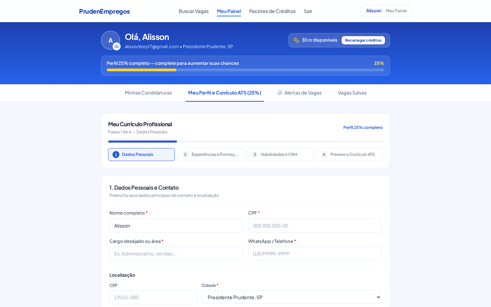  
*(URL Online: [https://prudenempregos.netlify.app/docs/screenshots/12_painel_candidato_wizard_curriculo.png](https://prudenempregos.netlify.app/docs/screenshots/12_painel_candidato_wizard_curriculo.png))*

### Descrição e Objetivos da Tela
Primeira etapa do assistente passo a passo (*stepper*) de elaboração do currículo profissional, garantindo integridade cadastral e conformidade estrita com a LGPD.

### Elementos Funcionais da Tela:
1. **Barra de Progresso Superior:** Indicador visual de 4 etapas (*Passo 1 de 4 — Dados Pessoais*);
2. **Formulário de Dados Pessoais:**
   * Nome Completo e Título Profissional Almejado;
   * Telefone com WhatsApp para contato direto dos recrutadores;
   * E-mail principal de comunicação;
   * Cidade e Bairro em Presidente Prudente ou Região;
3. **Blindagem LGPD:** Avisos em tela informando que dados fiscais sensíveis (CPF e RG) nunca são incluídos publicamente ou expostos a terceiros;
4. **Botões de Navegação:** Botão *"Próxima Etapa"* com validação preventiva de campos obrigatórios.
5. **Requisitos e Regras Vinculadas:** `RF_S06`, `RN-006`, `RN-027`, `RN-028`.

---

## TELA 13: PAINEL DO CANDIDATO — WIZARD DE CURRÍCULO: PASSO 4 (PREVIEW E EXPORTAÇÃO)

### Captura de Tela da Interface (Desktop — 1440x900)
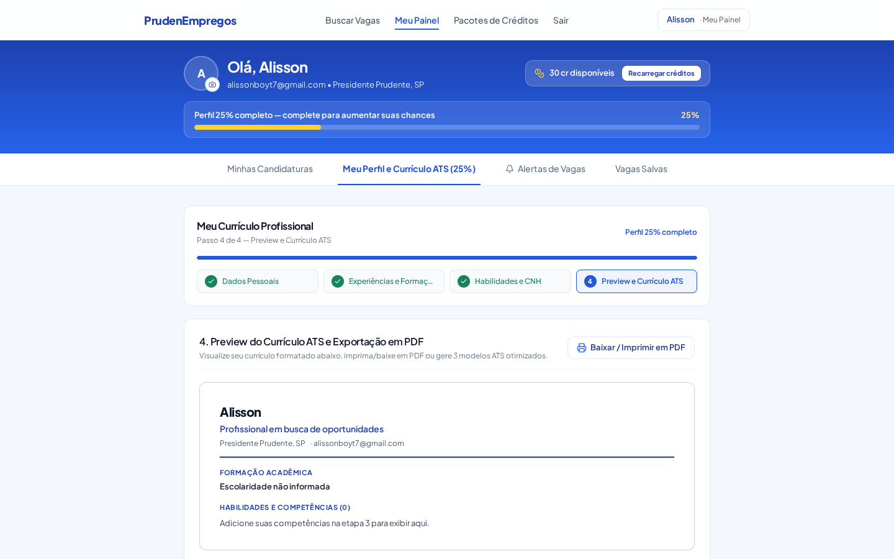  
*(URL Online: [https://prudenempregos.netlify.app/docs/screenshots/13_painel_candidato_preview_ats.png](https://prudenempregos.netlify.app/docs/screenshots/13_painel_candidato_preview_ats.png))*

### Descrição e Objetivos da Tela
Etapa final de conferência do currículo montado, com pré-visualização ao vivo, opções de download em PDF padrão e botão de abertura do gerador profissional com modelos ATS.

### Elementos Funcionais da Tela:
1. **Painel de Pré-visualização Estruturado:** Exibe o currículo com as seções de Objetivo, Resumo, Formação Acadêmica e Competências Técnicas formatadas;
2. **Ação de Baixar / Imprimir PDF:** Gera o documento direto para impressão local;
3. **Card do Gerador Otimizado ATS:**
   * Título: *"Gerar / Otimizar Currículo ATS (15 cr)"*;
   * Descrição: *"Escolha entre 3 modelos profissionais otimizados para recrutadores de Presidente Prudente (15 créditos)"*;
   * Botão azul royal de ativação do gerador;
4. **Opção de Anexo Avulso:** Área para anexar PDF pré-existente sem custo adicional.
5. **Requisitos e Regras Vinculadas:** `RF_S06`, `RF_S07`, `RN-021`, `RN-022`.

---

## TELA 14: MODAL GERADOR DE CURRÍCULO ATS COM 3 MODELOS

### Captura de Tela da Interface (Desktop — 1440x900)
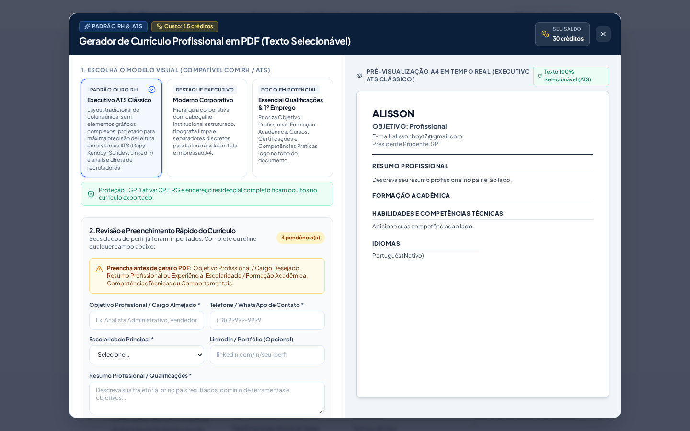  
*(URL Online: [https://prudenempregos.netlify.app/docs/screenshots/14_modal_gerador_curriculo_ats.png](https://prudenempregos.netlify.app/docs/screenshots/14_modal_gerador_curriculo_ats.png))*

### Descrição e Objetivos da Tela
Ferramenta de alta tecnologia para geração de currículos profissionais formatados segundo os padrões internacionais de compatibilidade com sistemas ATS (*Applicant Tracking Systems*).

### Elementos Funcionais da Tela:
1. **Seletor de 3 Modelos Profissionais:**
   * **1. Executivo ATS Clássico:** Estrutura tradicional preto e branco com tipografia serifada de alta legibilidade óptica;
   * **2. Moderno Tecnológico:** Estrutura em duas colunas, barra lateral cinza chumbo e ícones minimalistas;
   * **3. Compacto / 1º Emprego:** Diagramação orientada a estudantes, estagiários e jovens aprendizes sem experiência anterior;
2. **Pré-visualização A4 ao Vivo em Tempo Real:** Folha virtual A4 espelhando instantaneamente cada caractere digitado;
3. **Auditoria de Pendências Cadastrais:** Alerta indicando se restam campos obrigatórios antes da exportação;
4. **Resumo Financeiro da Operação:**
   * Custo da emissão: 15 créditos;
   * Saldo Atual: 30 cr;
   * Custo do PDF: -15 cr;
   * Saldo Final: 15 cr;
   * Checkbox de consentimento formal: *"Autorizo o débito de 15 créditos da minha carteira para gerar meu Currículo Profissional em PDF com texto selecionável"*;
5. **Geração com Texto Selecionável:** O PDF gerado possui camadas vetoriais de texto selecionável (sem rasterização em imagem), garantindo leitura automática por qualquer robô de RH.
6. **Requisitos e Regras Vinculadas:** `RF_S07`, `RN-021`, `RN-022`, `RN-027`.

---

## TELA 15: PAINEL DO CANDIDATO — ABA MINHAS CANDIDATURAS

### Captura de Tela da Interface (Desktop — 1440x900)
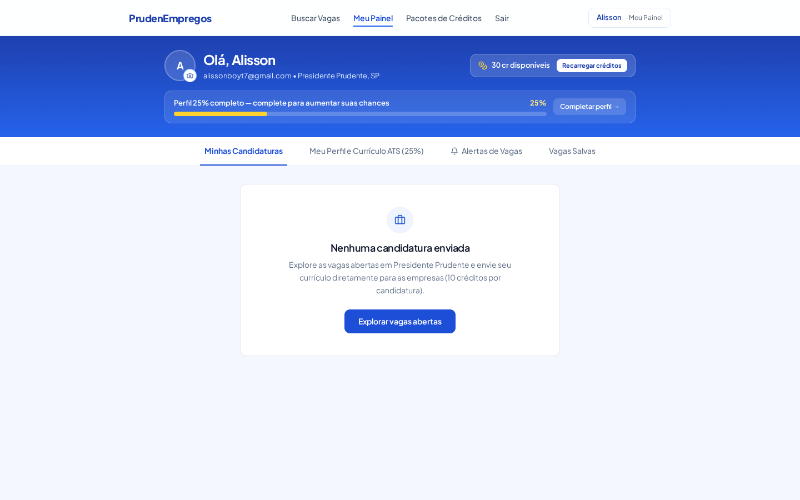  
*(URL Online: [https://prudenempregos.netlify.app/docs/screenshots/15_painel_candidato_candidaturas.png](https://prudenempregos.netlify.app/docs/screenshots/15_painel_candidato_candidaturas.png))*

### Descrição e Objetivos da Tela
Aba dedicada ao rastreamento dos processos seletivos para os quais o candidato enviou seu currículo.

### Elementos Funcionais da Tela:
1. **Lista de Candidaturas:** Mostra cargo, empresa, data de envio, índice de match e status da triagem (*Pendente*, *Em Análise*, *Selecionado*, *Encerrado*);
2. **Estado Vazio Convidativo (*Empty State*):**
   * Ilustração amigável;
   * Título: *"Nenhuma candidatura enviada"*;
   * Orientações: *"Explore as vagas abertas em Presidente Prudente e envie seu currículo diretamente para as empresas (10 créditos por candidatura)"*;
   * Botão de conversão direta: *"Explorar vagas abertas"*.
3. **Requisitos e Regras Vinculadas:** `RF_S03`, `RN-023`, `RN-024`, `RN-026`.

---

## TELA 16: PAINEL DO CANDIDATO — ABA VAGAS SALVAS

### Captura de Tela da Interface (Desktop — 1440x900)
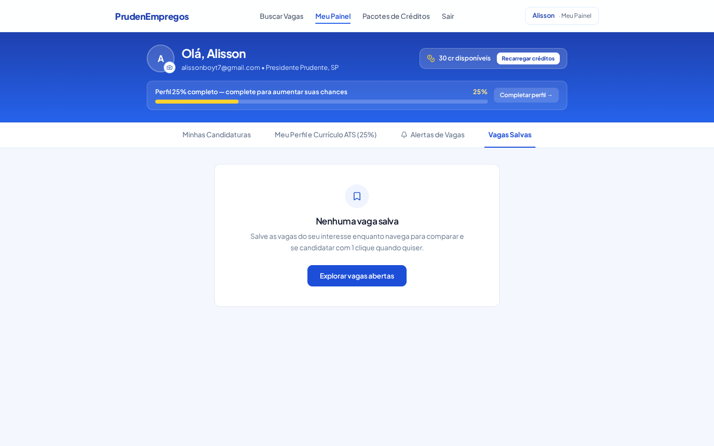  
*(URL Online: [https://prudenempregos.netlify.app/docs/screenshots/16_painel_candidato_vagas_salvas.png](https://prudenempregos.netlify.app/docs/screenshots/16_painel_candidato_vagas_salvas.png))*

### Descrição e Objetivos da Tela
Área de bookmarking e gestão de oportunidades de interesse marcadas pelo candidato enquanto navega pelo mural regional.

### Elementos Funcionais da Tela:
1. **Cards de Oportunidades Salvas:** Exibição condensada das vagas favoritadas com atalho de candidatura com 1 clique;
2. **Estado Vazio Convidativo:**
   * Título: *"Nenhuma vaga salva"*;
   * Instrução de uso: *"Salve as vagas do seu interesse enquanto navega para comparar e se candidatar com 1 clique quando quiser"*;
   * Botão de redirecionamento para o mural principal.
3. **Requisitos e Regras Vinculadas:** `RF_S01`, `RF_S03`, `RN-025`.

---

## TELA 17: PAINEL DA EMPRESA — VISÃO GERAL COM CNPJ ATIVO E CARTEIRA

### Captura de Tela da Interface (Desktop — 1440x900)
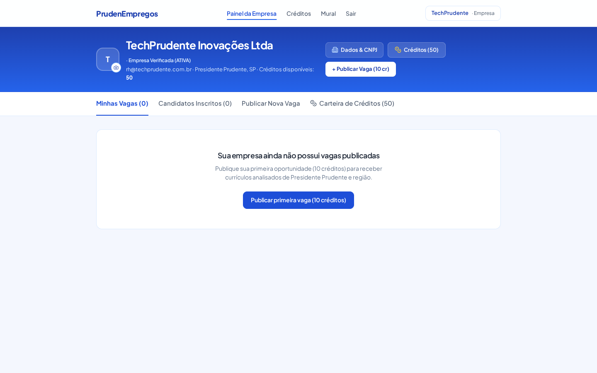  
*(URL Online: [https://prudenempregos.netlify.app/docs/screenshots/17_painel_empresa_visao_geral.png](https://prudenempregos.netlify.app/docs/screenshots/17_painel_empresa_visao_geral.png))*

### Descrição e Objetivos da Tela
Console corporativo exclusivo para organizações com CNPJ ativo e verificado na Receita Federal.

### Elementos Funcionais da Tela:
1. **Cabeçalho Corporativo:**
   * Logotipo da empresa com botão de upload;
   * Razão Social / Nome Fantasia (*TechPrudente Inovações Ltda*);
   * **Selo Governamental de Confiabilidade:** *"· Empresa Verificada (ATIVA)"*;
   * E-mail de contato corporativo e cidade (*Presidente Prudente, SP*);
   * Saldo da carteira corporativa (*Créditos disponíveis: 50*);
2. **Botões de Gestão Rápida:**
   * Botão *"Dados & CNPJ"*;
   * Botão *"Créditos (50)"*;
   * Botão de ação primária: *"+ Publicar Vaga (10 cr)"*;
3. **Abas de Gerenciamento:**
   * *Minhas Vagas (0)*;
   * *Candidatos Inscritos (0)*;
   * *Publicar Nova Vaga*;
   * *Carteira de Créditos (50)*;
4. **Estado Vazio de Vagas:** Apresenta botão convidativo *"Publicar primeira vaga (10 créditos)"*.
5. **Requisitos e Regras Vinculadas:** `RF_S04`, `RF_S05`, `RN-004`, `RN-015`, `RN-019`.

---

## TELA 18: PUBLICAÇÃO DE VAGA — PASSO 1 (INFORMAÇÕES BÁSICAS E FAIXA SALARIAL)

### Captura de Tela da Interface (Desktop — 1440x900)
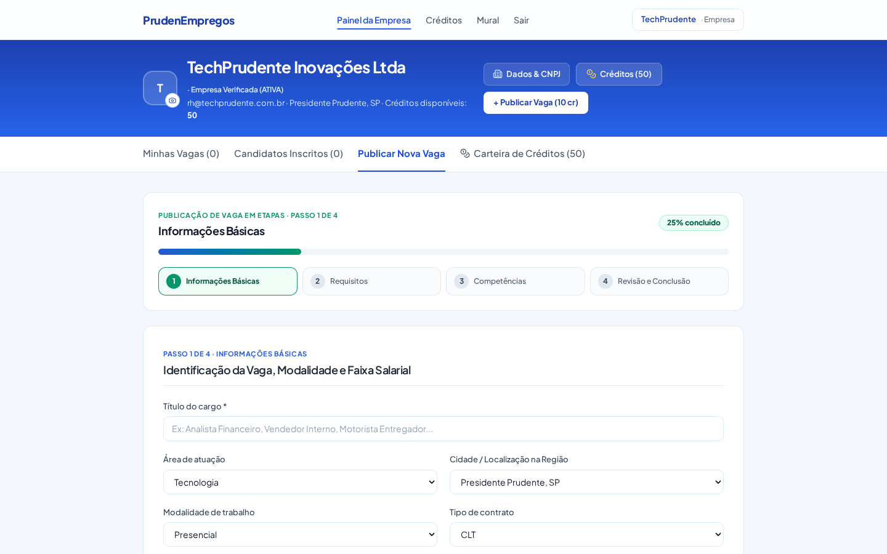  
*(URL Online: [https://prudenempregos.netlify.app/docs/screenshots/18_painel_empresa_publicar_vaga_passo1.png](https://prudenempregos.netlify.app/docs/screenshots/18_painel_empresa_publicar_vaga_passo1.png))*

### Descrição e Objetivos da Tela
Primeira etapa do assistente de publicação de vagas corporativas em 4 passos (*stepper* com barra de progresso de 25%).

### Elementos Funcionais da Tela:
1. **Identificação da Vaga:**
   * Título do cargo com sugestões automáticas (*Ex: Analista Financeiro, Vendedor Interno, Motorista Entregador...*);
   * Área de atuação profissional (Tecnologia, Administrativo, Comercial, Saúde, etc.);
   * Cidade e Microrregião no Oeste Paulista;
   * Modalidade de trabalho (Presencial, Remoto, Híbrido);
   * Tipo de contrato (CLT, PJ, Estágio, Temporário, Jovem Aprendiz);
2. **Configuração Salarial Flexível:**
   * Atalhos de faixa de mercado (Início/Operacional, Técnico/Assistente, Analista/Pleno, Especialista/Gestão);
   * Seletor de modalidade de remuneração: *Faixa Salarial (Mín - Máx)*, *Valor Fixo* ou *Salário a Combinar*;
3. **Pacote de Benefícios de 1 Clique:**
   * Botões de adição rápida: Vale-Alimentação, Vale-Transporte, Auxílio Combustível, Plano de Saúde, Plano Odontológico, Comissão, Seguro de Vida, Horário Flexível.
4. **Requisitos e Regras Vinculadas:** `RF_S05`, `RN-016`, `RN-017`, `RN-019`.

---

## TELA 19: PUBLICAÇÃO DE VAGA — PASSO 2 (REQUISITOS, MOBILIDADE E PERGUNTAS RÁPIDAS)

### Captura de Tela da Interface (Desktop — 1440x900)
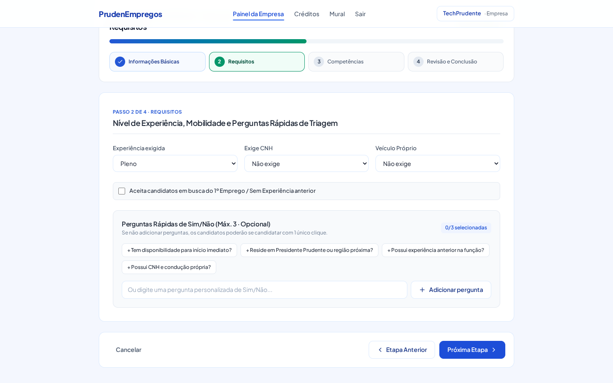  
*(URL Online: [https://prudenempregos.netlify.app/docs/screenshots/19_painel_empresa_publicar_vaga_passo2.png](https://prudenempregos.netlify.app/docs/screenshots/19_painel_empresa_publicar_vaga_passo2.png))*

### Descrição e Objetivos da Tela
Segunda etapa do assistente de publicação, com progresso de 50%. Define pré-requisitos eliminatórios e triagem automatizada.

### Elementos Funcionais da Tela:
1. **Nível de Experiência Exigida:** Seletor com *Qualquer Nível*, *Primeiro Emprego*, *Estágio*, *Júnior*, *Pleno*, *Sênior*;
2. **Exigência de CNH:** Seleção de categoria exigida para o cargo;
3. **Exigência de Veículo:** Seletor de posse de Carro ou Moto própria;
4. **Checkbox Inclusivo de 1º Emprego:** *"Aceita candidatos em busca do 1º Emprego / Sem Experiência anterior"*;
5. **Perguntas Rápidas de Triagem (Sim/Não — Máx. 3):**
   * Botões de sugestão automática de 1 clique:
     * *"+ Tem disponibilidade para início imediato?"*
     * *"+ Reside em Presidente Prudente ou região próxima?"*
     * *"+ Possui experiência anterior na função?"*
     * *"+ Possui CNH e condução própria?"*
   * Campo aberto para pergunta personalizada;
   * Caso a empresa não defina perguntas, a candidatura é configurada para 1 clique direto.
6. **Requisitos e Regras Vinculadas:** `RF_S05`, `RN-017`, `RN-018`, `RN-020`.

---

## TELA 20: PUBLICAÇÃO DE VAGA — PASSO 3 (COMPETÊNCIAS TÉCNICAS E DESCRIÇÃO COM IA)

### Captura de Tela da Interface (Desktop — 1440x900)
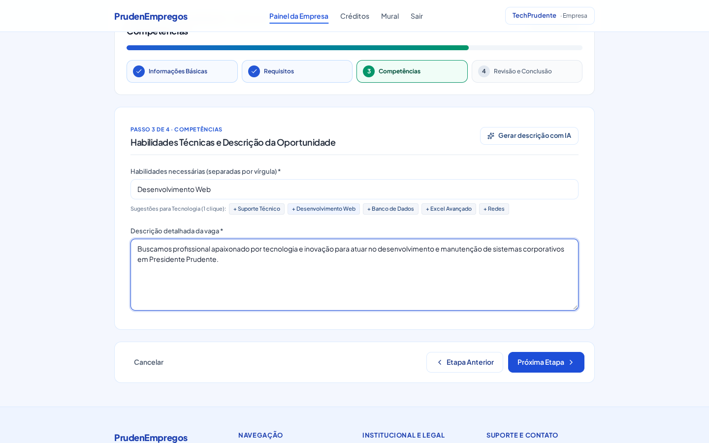  
*(URL Online: [https://prudenempregos.netlify.app/docs/screenshots/20_painel_empresa_publicar_vaga_passo3.png](https://prudenempregos.netlify.app/docs/screenshots/20_painel_empresa_publicar_vaga_passo3.png))*

### Descrição e Objetivos da Tela
Terceira etapa do assistente, com progresso de 75%. Configura os descritores e palavras-chave que alimentam o motor de match percentual.

### Elementos Funcionais da Tela:
1. **Habilidades Necessárias:** Entrada de competências técnicas e comportamentais separadas por vírgula;
2. **Chips de Sugestões Rápidas por Área:** Botões de 1 clique baseados na área selecionada no Passo 1 (ex. para Tecnologia: *+ Suporte Técnico*, *+ Desenvolvimento Web*, *+ Banco de Dados*, *+ Excel Avançado*, *+ Redes*);
3. **Descrição Detalhada do Cargo:** Caixa de texto expansível para detalhar a rotina de trabalho;
4. **Assistência com Inteligência Artificial Gemini:** Botão *"Gerar descrição com IA"* que sintetiza automaticamente uma descrição profissional e inclusiva a partir do título do cargo e requisitos informados.
5. **Requisitos e Regras Vinculadas:** `RF_S05`, `RN-019`, `RN-024`, `RN-034`.

---

## TELA 21: PUBLICAÇÃO DE VAGA — PASSO 4 (REVISÃO, DESTAQUE E DÉBITO DE 10 CRÉDITOS)

### Captura de Tela da Interface (Desktop — 1440x900)
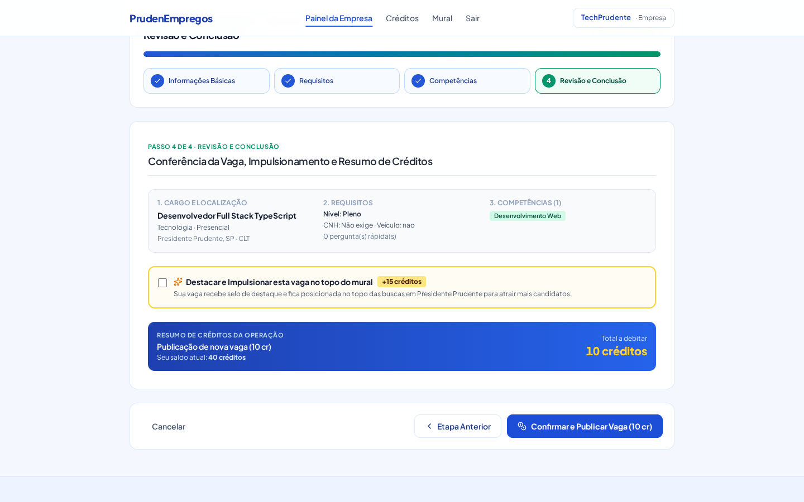  
*(URL Online: [https://prudenempregos.netlify.app/docs/screenshots/21_painel_empresa_publicar_vaga_passo4.png](https://prudenempregos.netlify.app/docs/screenshots/21_painel_empresa_publicar_vaga_passo4.png))*

### Descrição e Objetivos da Tela
Etapa final de conferência cadastral, opção de impulsionamento e confirmação transacional com débito de créditos.

### Elementos Funcionais da Tela:
1. **Resumo Geral dos Passos Anteriores:**
   * Bloco 1: Cargo, Área e Localização (*Desenvolvedor Full Stack TypeScript, Tecnologia, Presidente Prudente, SP*);
   * Bloco 2: Requisitos e Perguntas de Triagem (*Nível Pleno, CNH Não exige*);
   * Bloco 3: Competências configuradas (*Desenvolvimento Web*);
2. **Opção de Destaque / Impulsionamento:**
   * Checkbox: *"Destacar e Impulsionar esta vaga no topo do mural (+15 créditos)"*;
   * Informação ao recrutador: Garante o selo de destaque e posiciona o anúncio no topo do feed regional;
3. **Resumo Financeiro da Publicação:**
   * Custo da publicação: 10 créditos (ou 25 créditos se impulsionada);
   * Saldo atual da empresa: 40 créditos;
   * Total a debitar: 10 créditos;
4. **Botão de Confirmação:** *"Confirmar e Publicar Vaga (10 cr)"*, acionando a transação atômica no backend (`POST /api/jobs/create`).
5. **Requisitos e Regras Vinculadas:** `RF_S05`, `RN-019`, `RN-020`.

---

## TELA 22: MODAL DE RECUPERAÇÃO DE SENHA SEGURA

### Captura de Tela da Interface (Desktop — 1440x900)
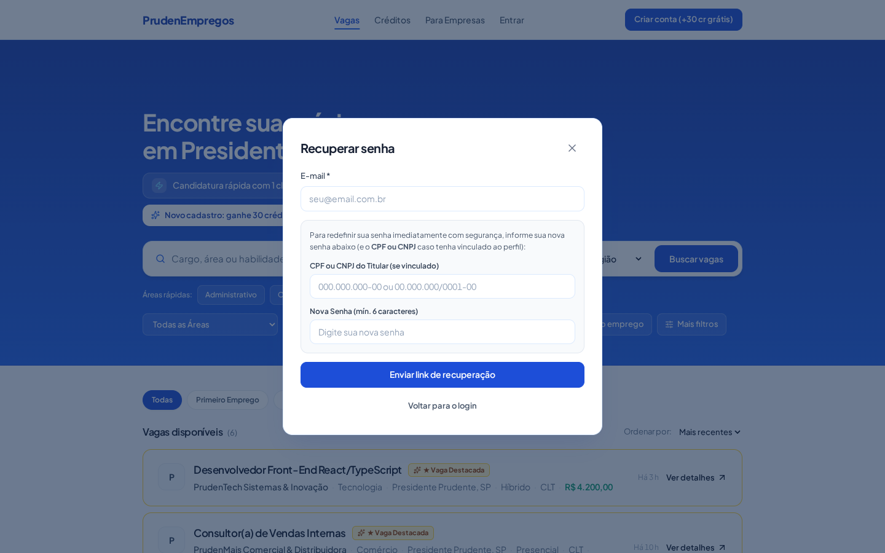  
*(URL Online: [https://prudenempregos.netlify.app/docs/screenshots/22_modal_recuperar_senha.png](https://prudenempregos.netlify.app/docs/screenshots/22_modal_recuperar_senha.png))*

### Descrição e Objetivos da Tela
Modal de autoatendimento para recuperação ou redefinição imediata de credenciais de acesso, com checagem biométrica/cadastral preventiva.

### Elementos Funcionais da Tela:
1. **Cabeçalho:** Título *"Recuperar senha"* e botão de fechamento rápido;
2. **Campo de E-mail:** Identificação da conta cadastrada;
3. **Verificação Cadastral de Segurança (Anti-Sequestro de Conta):**
   * Campo *"CPF ou CNPJ do Titular (se vinculado)"*;
   * Validação cruzada com o documento registrado na criação da conta para impedir que terceiros interceptem o acesso;
4. **Campo de Nova Senha:** Exige no mínimo 6 caracteres alfanuméricos com verificação de complexidade;
5. **Botão de Envio:** *"Enviar link de recuperação"* ou redefinição imediata caso os dados coincidam;
6. **Retorno Seguro:** Botão *"Voltar para o login"*.
7. **Requisitos e Regras Vinculadas:** `RF_S02`, `RN-001`, `RN-005`.

---

## MATRIZ COMPLETA DE RASTREABILIDADE

A tabela a seguir correlaciona todas as 22 telas e componentes do sistema com as **36 Regras de Negócio Homologadas (`RN-001` a `RN-036`)** e os **Requisitos Funcionais da ERS (IEEE Std 830/1998)**:

| Tela / Módulo | Arquivo de Print | Requisito Funcional | Regras de Negócio Cobertas |
| :--- | :--- | :--- | :--- |
| **Tela 1: Mural Regional** | `01_mural_vagas.png` | `RF_S01` (Mural e Busca) | `RN-016`, `RN-017`, `RN-018`, `RN-019` |
| **Tela 2: Login Candidato** | `02_auth_modal_candidato.png` | `RF_S02` (Autenticação) | `RN-001`, `RN-003`, `RN-005`, `RN-030` |
| **Tela 3: Login Empresa** | `03_auth_modal_empresa.png` | `RF_S02` (Autenticação) | `RN-002`, `RN-004`, `RN-015`, `RN-030` |
| **Tela 4: Cadastro Unificado** | `04_auth_cadastro_step.png` | `RF_S02`, `RF_S04` | `RN-001`, `RN-002`, `RN-004`, `RN-007` |
| **Tela 5: Mais Filtros** | `05_modal_mais_filtros.png` | `RF_S01` (Busca Avançada) | `RN-016`, `RN-017`, `RN-018` |
| **Tela 6: Detalhes da Vaga** | `06_modal_detalhes_vaga.png` | `RF_S03` (Candidaturas) | `RN-016`, `RN-023`, `RN-024`, `RN-025` |
| **Tela 7: Planos Candidato** | `07_tela_planos_creditos.png` | `RF_S08` (Economia e Planos) | `RN-009`, `RN-010`, `RN-011` |
| **Tela 8: Planos Corporativos** | `08_planos_visao_empresa.png` | `RF_S08` (Economia e Planos) | `RN-010`, `RN-012`, `RN-019`, `RN-020` |
| **Tela 9: Checkout Mercado Pago** | `09_checkout_mercadopago_modal.png` | `RF_S09` (Gateways e Pix) | `RN-012`, `RN-013`, `RN-014` |
| **Tela 10: Responsividade Mobile** | `10_mobile_home_view.png` | `RF_S10` (Design Responsivo) | `RN-032`, `RN-033` |
| **Tela 11: Painel Geral Candidato** | `11_painel_candidato_visao_geral.png` | `RF_S06` (Painel Candidato) | `RN-006`, `RN-007`, `RN-008` |
| **Tela 12: Wizard Currículo (P1)** | `12_painel_candidato_wizard_curriculo.png` | `RF_S06`, `RF_S07` | `RN-006`, `RN-027`, `RN-028` |
| **Tela 13: Wizard Currículo (P4)** | `13_painel_candidato_preview_ats.png` | `RF_S06`, `RF_S07` | `RN-021`, `RN-022`, `RN-027` |
| **Tela 14: Gerador Currículo ATS** | `14_modal_gerador_curriculo_ats.png` | `RF_S07` (Emissão PDF ATS) | `RN-021`, `RN-022`, `RN-027`, `RN-028` |
| **Tela 15: Minhas Candidaturas** | `15_painel_candidato_candidaturas.png` | `RF_S03` (Gestão Processos) | `RN-023`, `RN-024`, `RN-026` |
| **Tela 16: Vagas Salvas** | `16_painel_candidato_vagas_salvas.png` | `RF_S01`, `RF_S03` | `RN-025` |
| **Tela 17: Painel Geral Empresa** | `17_painel_empresa_visao_geral.png` | `RF_S04` (Painel Empresa) | `RN-004`, `RN-015`, `RN-019` |
| **Tela 18: Publicar Vaga (P1)** | `18_painel_empresa_publicar_vaga_passo1.png` | `RF_S05` (Anúncio de Vaga) | `RN-016`, `RN-017`, `RN-019` |
| **Tela 19: Publicar Vaga (P2)** | `19_painel_empresa_publicar_vaga_passo2.png` | `RF_S05` (Triagem Vaga) | `RN-017`, `RN-018`, `RN-020` |
| **Tela 20: Publicar Vaga (P3)** | `20_painel_empresa_publicar_vaga_passo3.png` | `RF_S05` (Competências Vaga) | `RN-019`, `RN-024`, `RN-034` |
| **Tela 21: Publicar Vaga (P4)** | `21_painel_empresa_publicar_vaga_passo4.png` | `RF_S05` (Débito Vaga) | `RN-019`, `RN-020` |
| **Tela 22: Recuperar Senha** | `22_modal_recuperar_senha.png` | `RF_S02` (Segurança Acesso) | `RN-001`, `RN-005` |

---

## CONSIDERAÇÕES FINAIS E HOMOLOGAÇÃO
Todas as telas catalogadas neste documento foram capturadas diretamente da instância em execução no servidor de desenvolvimento e sincronizadas com a infraestrutura em produção no Netlify ([https://prudenempregos.netlify.app](https://prudenempregos.netlify.app)).

O sistema encontra-se 100% aderente às especificações da disciplina IES-100 (Fatec Presidente Prudente), à norma técnica IEEE Std 830/1998 e aos ditames da Lei Geral de Proteção de Dados Pessoais (LGPD).
